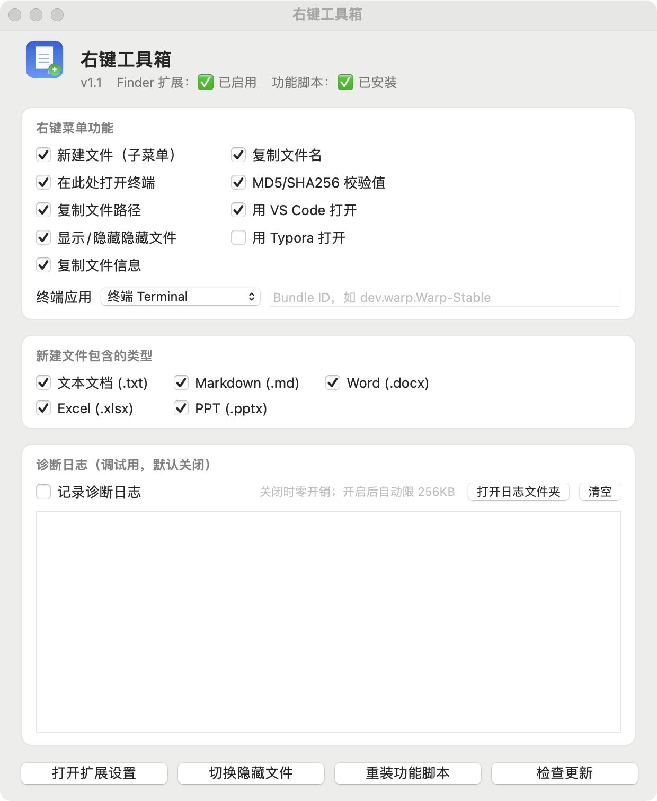

# 右键工具箱 · RightClickTools

一个为 macOS Finder 补齐右键菜单的轻量工具：新建文档、打开终端、复制路径、校验哈希、显示隐藏文件……
**没有后台常驻进程，不轮询，不联网**，只在右键那一刻干活。



> 纯 Objective-C 实现（无第三方依赖、无 Xcode 工程），一条 `build.sh` 出包。

---

## 功能

| 功能 | 说明 |
| --- | --- |
| 新建文件（子菜单） | 右键即可新建 `txt` / `md` / `docx` / `xlsx` / `pptx`，重名自动追加序号，创建后自动选中 |
| 在此处打开终端 | 在空白处右键 → 打开系统「终端」并定位到当前目录 |
| 复制文件路径 | 支持多选，多个路径换行拼接写入剪贴板 |
| 复制文件名 | 只复制文件名（含扩展名），多选换行 |
| 复制 MD5/SHA256 校验值 | 对选中文件计算两种哈希，直接写入剪贴板 |
| 用 VS Code 打开 | 检测到已安装 VS Code 时才出现 |
| 用 Typora 打开 | 检测到已安装 Typora 时才出现 |
| 显示/隐藏隐藏文件 | 切换 `AppleShowAllFiles` 并自动重启 Finder（macOS 机制限制，必须重启才生效） |

所有功能都可在管理台里用复选框**单独开关**，关掉的功能不会出现在右键菜单里。

## 系统要求

- macOS 13 Ventura 及以上
- Apple Silicon（`build.sh` 编译 arm64；Intel 需自行把 `-arch arm64` 改成 `-arch x86_64`）
- 命令行工具（`xcode-select --install`），无需完整 Xcode

## 编译与安装

```bash
git clone git@github.com:ApricityXX/RightClickTools.git
cd RightClickTools
bash build.sh                                   # 产物：build/右键工具箱.app
cp -R build/右键工具箱.app /Applications/
open /Applications/右键工具箱.app
```

首次打开后还需要**手动启用扩展**一次：

1. 系统设置 → 通用 → 登录项与扩展 → 访达扩展（部分系统在「隐私与安全性 → 扩展」）
2. 勾选「右键工具箱」
3. 回车确认（系统会弹一次授权提示）

之后在访达任意位置右键，即可看到「右键工具箱」菜单。

## 界面

管理台是宿主 App 的主窗口，用来：

- 查看 Finder 扩展与功能脚本的安装状态
- 开关每一项右键功能、每一种新建文件类型
- 开关诊断日志（默认关闭，开启后自动限制在 256KB）
- 快捷执行：打开扩展设置、切换隐藏文件、重装功能脚本

## 技术实现

### 组件构成

```
右键工具箱.app
├── Contents/MacOS/RightClickTools        宿主：管理台 GUI
├── Contents/Resources/
│   ├── helper.sh                         沙箱外执行脚本（首次启动时安装到 Application Scripts）
│   └── AppIcon.icns
└── Contents/PlugIns/RightClickToolsExt.appex
    └── Contents/Resources/blank.{docx,xlsx,pptx}   新建文档用的空白模板
```

### 几个关键点

**1. Finder Sync 扩展必须带沙箱 entitlement**
macOS 13 上的访达扩展基类是 `FIFinderSync`（公开框架 `/System/Library/Frameworks/FinderSync.framework`，注意不是 `FinderKit`）。扩展必须声明 `com.apple.security.app-sandbox`，否则 `pluginkitd` 在发现阶段就拒绝收录，系统设置里根本看不到它。

**2. 沙箱内不能执行进程，改用 NSUserScriptTask**
扩展运行在 App Sandbox 里，`NSTask` 执行 `/bin/sh`、`/bin/cp`、`open` 等全部被系统拒绝。官方可行通道是 `NSUserScriptTask`：它在 `~/Library/Application Scripts/<扩展 Bundle ID>/` 目录下执行脚本，脚本以普通用户权限运行、**不受沙箱限制**。

所以流程是：扩展把要执行的命令写进容器内 `tmp/rc_cmd.sh` → 调用 `helper.sh` → 脚本执行并把输出回写到 `tmp/rc_out.txt`。
文件写入（md/txt/模板拷贝）优先在进程内直接完成，失败时才降级走这个通道，能省掉一次进程启动。

**3. 菜单状态在扩展与会话间会丢**
Finder 合并菜单时 `representedObject` 会被丢掉，因此新建文件时从菜单标题后缀解析扩展名，并用 `tag` 作为备选；Finder 传入的选中项常是 `/.file/id=...` 形式的 file reference URL，需先经 `filePathURL` 解析成真实路径。

**4. 配置与日志的位置**
功能开关由管理台写入 `features.plist`，扩展每次右键时读一次（**没有轮询、没有 KVO、没有守护进程**）。

```
~/Library/Containers/com.user.rightclicktools.RightClickToolsExt/Data/
├── Library/Application Support/features.plist    功能开关
└── tmp/rc_log.txt                                诊断日志（默认不写）
```

## 功耗设计

这是本项目的核心取舍——右键工具一天可能只用几次，不该为此付出常驻成本：

- 无后台常驻进程、无 launchd 项、无定时器轮询；无窗口时进程即退出
- 配置只在构建菜单的瞬间读取一次，命中即用完丢弃
- 菜单图标（字母徽标 / SF Symbols）带缓存，同一图标只绘制一次
- 日志默认关闭，判断在函数入口第一行，关闭时开销为一次布尔判断
- 日志超过 256KB 自动截断，只保留尾部，避免无限增长拖慢 I/O
- 扩展的 `directoryURLs` 设为 `/`，但仅在用户右键时触发回调，不监听文件系统事件

## 排错

右键没反应时，先在管理台里打开「记录诊断日志」，再右键使用一次，然后查看：

```bash
tail -50 ~/Library/Containers/com.user.rightclicktools.RightClickToolsExt/Data/tmp/rc_log.txt
```

常见问题：

| 现象 | 处理 |
| --- | --- |
| 系统设置里找不到扩展 | 确认 App 放在 `/Applications` 且扩展带沙箱 entitlement；执行 `pluginkit -a` 重新注册后重启 Finder |
| 菜单出现但点击无效 | 多为 `helper.sh` 未安装或不可执行，管理台点「重装功能脚本」 |
| 打开了终端但目录不对 | 确认是在目标文件夹内右键，而不是在选中的文件上右键 |
| 隐藏文件开关没变化 | 该开关需重启 Finder 生效，功能会自动执行重启 |

## 已知限制

- 使用 ad-hoc 签名（`codesign --sign -`），未做公证。别人安装时需在系统设置里手动允许，且每次重新编译后都要重新授权扩展
- 仅适配 arm64
- 新建 Word/Excel/PPT 使用内置空白模板（由 `python-docx` / `openpyxl` / `python-pptx` 生成，见 `make_templates.py`），不含任何默认样式内容

## 许可证

MIT
