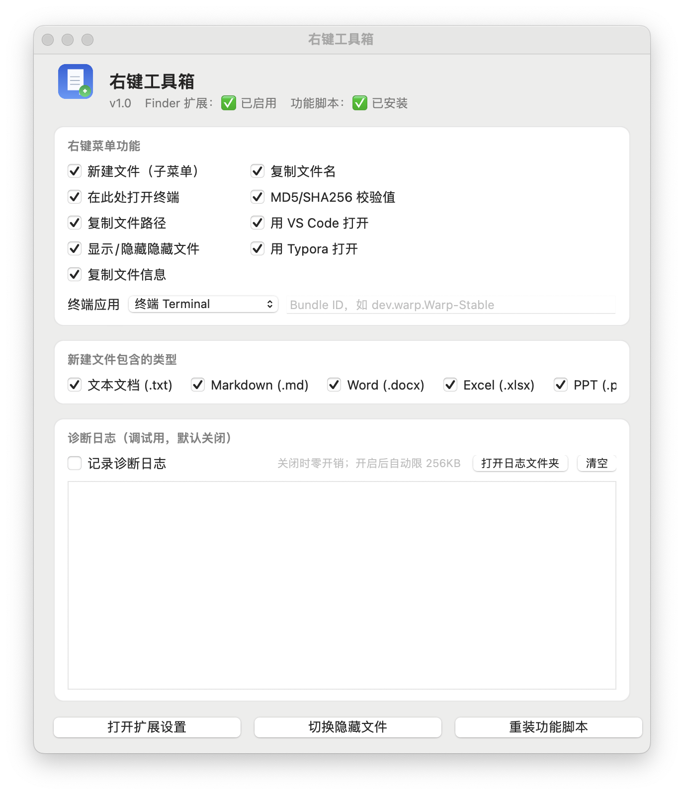

# 右键工具箱 · RightClickTools

[](https://github.com/ApricityXX/RightClickTools/actions/workflows/release.yml)
[](https://github.com/ApricityXX/RightClickTools/actions/workflows/ci.yml)
[](https://github.com/ApricityXX/RightClickTools/releases/latest)
[](LICENSE)

给 macOS 访达补齐右键菜单：新建文档、打开终端、复制路径、算哈希、显隐隐藏文件。
纯 Objective-C，无第三方依赖，**没有后台常驻进程、不轮询、不联网**。



> 当前版本 **v1.0**（首个正式版）。早期 0.x～1.x 测试版已全部下架，从 v1.0 重新计版本。

---

## 安装

### 方式一：下载现成的

到 [Releases](https://github.com/ApricityXX/RightClickTools/releases/latest) 下载 `RightClickTools-<版本>-arm64.zip`，解压后：

```bash
# 把 App 拖进 /Applications，再解除隔离（未公证，必须做）
xattr -dr com.apple.quarantine "/Applications/右键工具箱.app"
open "/Applications/右键工具箱.app"
```

### 方式二：让 AI 帮你装

不想自己敲命令，把下面整段丢给 AI 助手，让它全程代劳：

````text
请在这台 Mac 上帮我安装并启用开源工具「右键工具箱 / RightClickTools」，自己执行命令，不要只给我步骤。

1. 环境：macOS 13+ 即可。先跑 xcode-select -p，报错就执行 xcode-select --install
   （只需命令行工具）；它会弹图形安装窗口，需要我手动点「安装」并等下载完成，装完再继续。
2. 克隆并编译：
   git clone https://github.com/ApricityXX/RightClickTools.git ~/RightClickTools
   cd ~/RightClickTools && bash build.sh          # 产物：build/右键工具箱.app，默认按本机架构编译
   若 ~/RightClickTools 已存在，就进去 git pull，不要删——可能是我改过的源码。
3. 安装到 /Applications（路径含中文，必须加引号，且不要用 sudo）：
   pkill -f RightClickTools
   rm -rf "/Applications/右键工具箱.app"
   cp -R "build/右键工具箱.app" /Applications/
   自己编译的包没有 quarantine 属性，不用 xattr；只有从 zip 解压来的才要：
   xattr -dr com.apple.quarantine "/Applications/右键工具箱.app"
4. 打开一次，让它把功能脚本装到位：
   open "/Applications/右键工具箱.app"
   等 3 秒，然后确认 ~/Library/Application Scripts/com.user.rightclicktools.RightClickToolsExt/helper.sh
   存在且可执行（ls -l 权限应为 755）。缺失就手动从 App 包内 Resources/helper.sh 复制过去并 chmod +x。
5. 重启访达让扩展生效：killall Finder
6. 停下来提醒我：到「系统设置 → 隐私与安全性 → 扩展 → 访达扩展」勾选「右键工具箱」
   （macOS 14 及以上在「系统设置 → 通用 → 登录项与扩展 → 访达扩展」）。这一步只能我手动点。

注意（逐条自查，别在这些点上浪费时间）：
- 别用 pluginkit 判断成败。macOS 13 上 pluginkit -a 会报 invalid plugin path，pluginkit -m 会报
  unauthorized discovery flag。App 从 /Applications 打开后系统会自动收录扩展，killall Finder 即可生效。
- 扩展必须带 com.apple.security.app-sandbox entitlement，否则系统设置里根本不显示。build.sh 已内置这一步；
  若手动重签，务必保留 --entitlements，不要用裸 codesign --sign -。
- 扩展在沙箱内运行，不能 NSTask 起进程，所有功能靠 NSUserScriptTask 调 helper.sh。
  helper.sh 缺失或不可执行的表现就是「菜单有、点了没反应」——回第 4 步检查。
- 不要用 sudo 跑 build.sh 或 cp，产物属主会变 root，签名和写日志都会失败。
- build.sh 默认按本机架构编译，官方 Release 只提供 arm64。Intel 机器直接跑 build.sh 会编出 x86_64（未充分测试）。
- git clone 若被网络拦（502 / timeout），改用镜像：https://ghfast.top/https://github.com/ApricityXX/RightClickTools.git
  实在不行就退回方式一直接下 Release 包。
- ad-hoc 签名且未公证，每次重新编译安装后都要回系统设置重新勾选一次扩展。
- 本机若装了「超级右键」iRightMouse 等同类工具，先退出，否则会抢同一菜单层级。

验收（两条都满足才算成功）：
1. 任意文件夹空白处右键，出现「右键工具箱」子菜单；
2. 打开管理台，状态栏显示「✅ 已启用」「✅ 已安装」。
若点击无反应：在管理台打开「记录诊断日志」→ 再右键用一次 → 读
~/Library/Containers/com.user.rightclicktools.RightClickToolsExt/Data/tmp/rc_log.txt
````

### 方式三：自己编译

需要 macOS 13+、命令行工具（`xcode-select --install`，不用完整 Xcode）。

```bash
git clone git@github.com:ApricityXX/RightClickTools.git
cd RightClickTools
bash build.sh                          # 产物：build/右键工具箱.app
cp -R build/右键工具箱.app /Applications/
open "/Applications/右键工具箱.app"
```

`build.sh` 默认按本机架构编译（`ARCH=` 可覆盖），官方 Release 只有 arm64。

> `build.sh` 固定 `-mmacosx-version-min=13.0`，否则在高版本系统上编出的包在 macOS 13 上会报 `-10825 kLSIncompatibleSystemVersionErr`。可用 `MACOS_MIN=` 覆盖。

### 三种方式都必经：启用扩展

装好之后，**系统设置 → 隐私与安全性 → 扩展 → 访达扩展**，勾选「右键工具箱」（macOS 14+ 在「系统设置 → 通用 → 登录项与扩展 → 访达扩展」）。

之后在访达任意位置右键，就能看到「右键工具箱」子菜单。

## 功能

| 功能 | 说明 |
| --- | --- |
| 新建文件（子菜单） | `txt` / `md` / `docx` / `xlsx` / `pptx`，重名自动加序号，创建后自动选中 |
| 在此处打开终端 | 默认终端；管理台可选 iTerm2 / Warp / WezTerm / 自定义 bundle ID，未安装时自动回退系统终端 |
| 复制文件路径 / 文件名 | 支持多选，换行拼接（纯文本，粘到哪都是字符串） |
| 复制文件信息 | 文件名 / 大小 / 修改时间 / 路径，结构化文本，写文档、提 issue 直接用 |
| 复制 MD5 / SHA256 | 两个值一起算，直接进剪贴板，算完弹系统通知 |
| 用 VS Code / Typora 打开 | 装了才出现 |
| 切换隐藏文件（⌘⇧.） | 等价于按 `⌘⇧.`：只切换当前访达窗口、**不重启访达**。首次使用点一次会弹系统的「辅助功能」授权引导，打开「右键工具箱」的开关即可 |

每项都能在**管理台**里单独开关，关掉的不出现在菜单里。管理台还负责：查看扩展与脚本安装状态、开关诊断日志（默认关）、一键重装功能脚本、快速跳转系统扩展设置。

## 常见问题

| 现象 | 处理 |
| --- | --- |
| 系统设置里找不到扩展 | App 必须在 `/Applications`；重启一次访达（`killall Finder`）再看 |
| 菜单出来了，点了没反应 | 多为 `helper.sh` 没装上或不可执行，管理台点「重装功能脚本」 |
| 打开终端但目录不对 | 要在文件夹空白处右键，不是在选中的文件上 |
| 切换隐藏文件没反应 | 需要「辅助功能」权限：点一次功能会弹系统授权引导，打开对应开关后，退出并重开一次 App 再试 |
| 重装后菜单消失 | ad-hoc 签名变了，回系统设置重新勾选扩展；「辅助功能」授权同样要重新给一次 |

调试：管理台开「记录诊断日志」→ 右键用一次 → 读上面的 `rc_log.txt`。

## 开发

- 目录：`src/`（`ExtMain.m` 扩展、`HostMain.m` 管理台）、`resources/`（plist、`helper.sh`、图标）、`templates/`（Office 空白模板，`make_templates.py` 生成）、`gen_icon.m`（生成 `AppIcon.icns`）
- 发版：版本号以 git tag 为唯一来源，CI 自动写进两个 plist 并出包

  ```bash
  git tag -a v1.0.1 -m "改动说明" && git push origin v1.0.1
  ```

  tag 带 `-`（如 `v1.0.1-beta.1`）自动标 prerelease。本地想手动改版本用 `bash set_version.sh 1.0.1 [build号]`。

## 许可证

MIT
